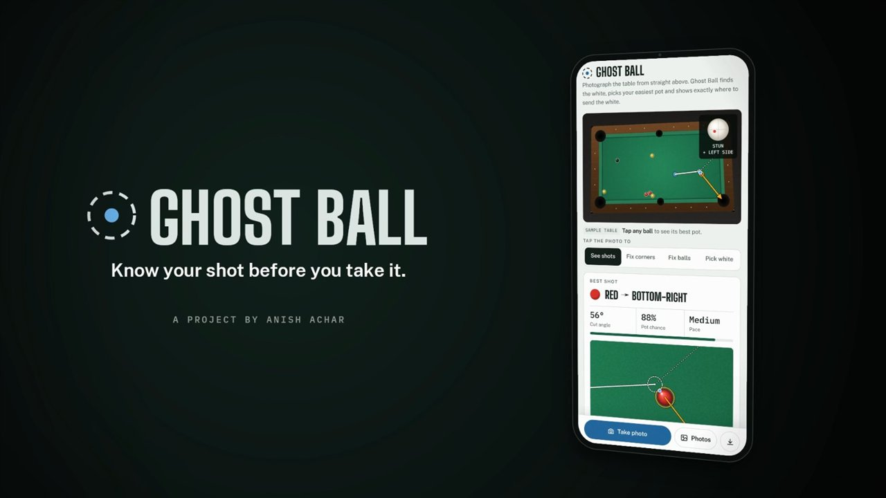
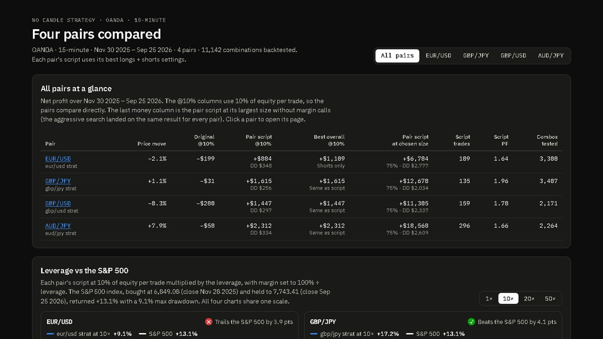
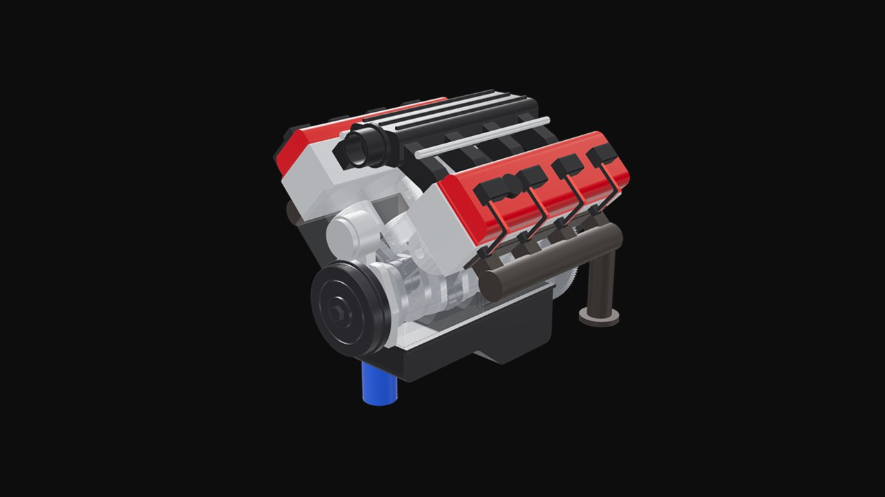
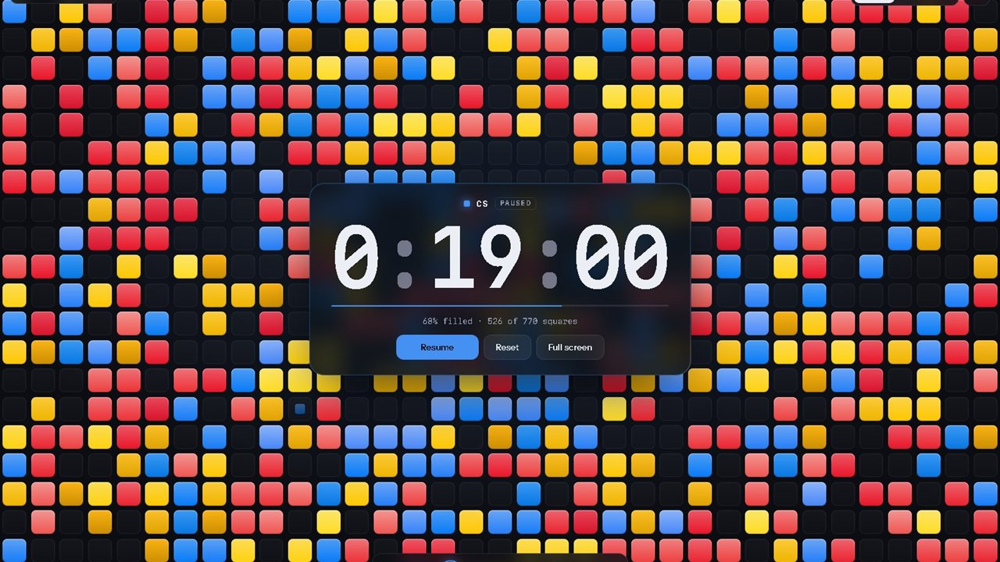
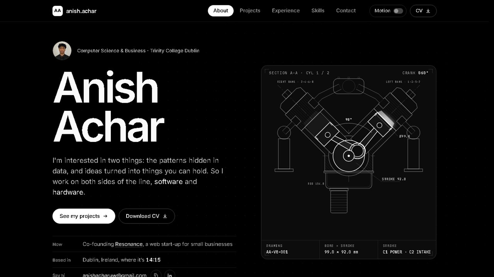

## Hi, I'm Anish 👋

Computer Science & Business student at **Trinity College Dublin**. I'm interested in two things: the patterns hidden in data, and ideas turned into things you can hold. So I work on both sides of the line, **software and hardware**.

Right now I'm co-founding **Resonance**, a web start-up that rebuilds outdated websites for small businesses.

---

### Projects

<table>
  <tr>
    <td width="50%" valign="top">
      
      <h4><a href="https://github.com/Anish-Achar/ghost-ball">Ghost Ball</a></h4>
      Take one photo of a pool table and it finds your easiest pot: computer vision, geometry and probability, all in the browser on your phone.
        <code>JavaScript</code> <code>Computer vision</code> · <a href="https://anishachar.com/ghost-ball/">Try it</a>
    </td>
    <td width="50%" valign="top">
      
      <h4><a href="https://github.com/Anish-Achar/no-candle-strategy">NO Candle Strategy</a></h4>
      A rule-based trading strategy tuned over 11,142 backtests on four FX pairs. The original settings lost money on all four; the tuned versions are profitable on all four.
        <code>Pine Script</code> <code>Backtesting</code> · <a href="https://anish-achar.github.io/no-candle-strategy/dashboard/">Dashboard</a>
    </td>
  </tr>
  <tr>
    <td width="50%" valign="top">
      
      <h4><a href="https://github.com/Anish-Achar/v8-engine">V8 Engine</a></h4>
      A working 40-part V8 in SOLIDWORKS, generated entirely by a C# program driving the SOLIDWORKS API. Turn the crank and all 8 pistons move.
        <code>SOLIDWORKS</code> <code>C#</code> · <a href="https://anishachar.com/#projects/v8">Explore in 3D</a>
    </td>
    <td width="50%" valign="top">
      
      <h4><a href="https://github.com/Anish-Achar/study-mosaic">Study Mosaic</a></h4>
      A study timer that fills your screen with coloured squares as you work, one colour per subject, with a full stats dashboard.
        <code>JavaScript</code> <code>Canvas</code> · <a href="https://anish-achar.github.io/study-mosaic/">Open the app</a>
    </td>
  </tr>
  <tr>
    <td width="50%" valign="top">
      
      <h4><a href="https://github.com/Anish-Achar/anishachar.com">anishachar.com</a></h4>
      My portfolio site: hand-built with no framework, with interactive 3D models, live charts and zero third-party requests.
        <code>HTML/CSS/JS</code> <code>three.js</code> · <a href="https://anishachar.com">Visit</a>
    </td>
    <td width="50%" valign="top">
      <h4>Also on my site</h4>
      <ul>
        <li><a href="https://anishachar.com/#projects/fincan">Rocket fin can</a>: flight-simulated, flutter-checked fins with a 3D flutter lab</li>
        <li><a href="https://anishachar.com/#projects/zeto">Zeto</a>: our hackathon internship tracker with two-way Notion sync</li>
        <li><a href="https://anishachar.com/#projects/biking">Bikes & mechanics</a>: rebuilds for people in need, and an e-bike kit</li>
        <li><a href="https://anishachar.com/#projects/tiktok">Study content</a>: 31K+ views on my top three TikTok videos</li>
      </ul>
    </td>
  </tr>
</table>

### Tools I use

`Python` · `JavaScript` · `C#` · `Pine Script` · `SOLIDWORKS` · `three.js` · `Figma` · `Flight simulation` · `Technical drawing`
